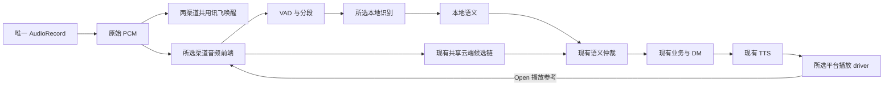

# 8295 端侧开放语音渠道架构与构建设计

日期：2026-11-08。状态：方案已整理，功能尚未实施，native 构建和实机验收尚未执行。源码基线：`67508b5`。

在保留现有讯飞渠道行为的前提下，新增编译时选择的 `open` 渠道：复用现有独立讯飞唤醒，WebRTC 负责端侧信号处理和 VAD，FireRedASR2 负责端侧语音转写，现有业务、对话、仲裁、云端服务和 TTS 继续复用。`open` 表示前端与 ASR 使用开源实现，不表示 APK 完全移除讯飞 SDK。目标设备由用户指定为 8295；设备内存、Android 版本和车厂音频接口在设备验证阶段确认。

## 1 现有架构核对

当前模块划分符合语音能力与业务分离的方向，仍存在过渡装配。增加新渠道应完善替换边界，避免复制整套引擎或业务。

| 边界 | 当前源码事实 | 本次处理 |
| --- | --- | --- |
| 业务和引擎 | `voice-business` 已拥有 DM、导航与回复调度；App 的 `VoiceEngine` 仍接收 TTS、BusinessHandler 并持有业务服务 | 共用已有业务服务；新增渠道不增加 DM。完整 DefaultVoiceEngine 迁移继续按原设计分期进行 |
| ASR 和 NLU | `AsrModule`、`NluModule` 已存在；本地 `LocalAsrEngine` 返回空，`LocalNluEngine` 调讯飞命令识别器并忽略 ASR 文本 | 保持旧命令路径，增加独立消费 FireRed final 文本的规则 NLU |
| 音频前端 | 有 `AudioFrontendEngine`、`FrontendSignalProcessor`、`VadEngine` 接口；工厂、帧长、门控仍按 RNNoise 和 Silero 固定装配 | 分离公共契约及算法实现，新增 WebRTC 组合 |
| 厂商装配 | `VoiceEngineFactory` 引用讯飞离线 SDK，`MainViewModel` 直接创建讯飞唤醒器 | 识别实现移到渠道 source set；两个渠道通过公共唤醒工厂复用独立的讯飞观察者，业务/UI 仅接收端口 |
| 配置 | `voice-core/Config.kt` 固定校验讯飞 ASR、RNNoise 和规则 NLU 名称 | 通用参数校验保留，渠道支持矩阵由组合根注入 |
| 构建 | App 无条件依赖 `adapter-iflytek`；音频模块无条件携带 RNNoise native 与 Silero/ONNX Runtime | 按 flavor 选择完整依赖集合并验收 APK 内容 |
| 设计与现状 | 旧拆分文档仍将部分文本入口、realtime 门禁列为未完成，源码已有实现 | 本次以源码为基线；不重复实现文本入口，不把所有旧待办当成当前缺陷 |

本次复评已重新执行 `voice-core` 35 项、`voice-engine` 24 项、`voice-business` 43 项测试，均无失败、错误或跳过。该验证覆盖现有模块逻辑，不代表已验证 WebRTC、FireRed 或 8295 实机性能。

## 2 FireRed 支持情况和方案选择

FireRed 开源模型支持端侧和自建云端两种运行路径，两者使用的运行时不同。

| 方案 | 支持依据与差异 | 本项目选择 |
| --- | --- | --- |
| Android 端侧 CTC INT8 | sherpa-onnx 提供 FireRedASR2 CTC 转换模型、Android 示例和 APK；模型文件约 740MB，仅保留 CTC 分支 | 用户选择端侧方向；本文建议首版采用此变体，先做 CPU 基线 |
| Android 端侧 AED INT8 | 同一项目提供 encoder 约 779MB、decoder 约 398MB 的转换版本，资源与解码成本不同 | 作为离线精度对照，不作为首版默认配置 |
| 自建云端 AED 服务 | FireRed 官方仓库提供 Triton/TensorRT 客户端服务端部署及 HTTP 客户端 | 后续可增加服务端 AsrProvider；本次不建设新的云端 ASR 服务 |

支持 Android 的证据来自 sherpa-onnx 的适配，不意味着 FireRed 原仓库提供可直接嵌入的 Android SDK。CTC 转换模型的精度也不能直接套用完整 AED/LLM 的基准数字。[端侧模型及 Android 示例](https://k2-fsa.github.io/sherpa/onnx/FireRedAsr/pretrained.html)

FireRed 官方仓库的云端方案可自建部署，不等于已有公共托管 API；其服务端批量性能数据不能作为端侧时延预算。[官方服务部署](https://github.com/FireRedTeam/FireRedASR2S/blob/main/runtime/triton_tensorrt/README.md)

8295 先使用 `arm64-v8a` CPU 推理作为可移植基线，推理线程数由设备测试决定。QNN/HTP 加速作为后续独立优化，需要针对该模型、算子、量化方式、设备驱动及权限验证，不把芯片拥有 NPU 当作模型已经获得加速的证据。[sherpa-onnx QNN 支持入口](https://k2-fsa.github.io/sherpa/onnx/qnn/index.html)

## 3 首版范围

目标是构建两个独立渠道的客户端，讯飞包保留现有行为，Open 包能在模型已安装、无网络时完成本地转写及已有规则可理解的本地命令。通用在线理解、检索、导航信源和云端 TTS 仍遵循现有联网条件，不能把离线 ASR 等同于所有业务离线可用。

首版 Open 使用 WebRTC VAD 分段后识别，仅交付真实 final，不承诺逐字 partial。sherpa-onnx 的模拟流式示例基于非流式模型运行；若后续增加周期性重识别，partial 可修订，仍以最终分段结果为准。[模拟流式定义](https://k2-fsa.github.io/sherpa/onnx/android/prebuilt-apk.html)

唤醒与 ASR 分开。用户要求在现有唤醒独立时复用；源码确认其观察者和端口独立，因此首版 Open 继续使用 `IflytekWakeWordObserver`，保留现有 UI 按键及硬件按键事件。报告是否支持唤醒及其实际初始化/授权状态，不通过持续全量 ASR 模拟唤醒。两个渠道均需要讯飞唤醒的有效凭据、资源和授权。

本次不改端云补槽/确认协议，不更换云端 ASR 或业务模型，不建设第二套 DM，不引入运行时切渠道，也不将 QNN 加速、模拟流式或多麦阵列波束形成作为首版前提。

## 4 模块和装配边界

沿用现有功能模块，新模块以实际依赖隔离为目的：



图中 Frontend→Cloud 表示 Open 的处理后音频；讯飞渠道保留原始音频上云的既有行为。图中箭头为运行时数据流，厂商适配器不在编译期依赖业务或 DM。

| 模块 | 职责 |
| --- | --- |
| `audio-frontend` | 保留公共前端契约、PCM 格式、音频块、分段与门控公共逻辑；移出具体算法、模型和 native 构建依赖 |
| `audio-frontend-legacy` | 从现模块迁入 RNNoise、Silero、当前工厂和系统采集效果实现，保持讯飞渠道原处理顺序、参数与格式 |
| `adapter-webrtc` | WebRTC APM/VAD native 库、JNI、10ms 重分帧、播放参考处理、AEC 健康状态 |
| `adapter-firered` | sherpa-onnx Android 运行时、模型加载、分段识别、线程与资源收尾 |
| `adapter-iflytek` | 首版两渠道共用其中的唤醒观察者和 AIKit runtime；讯飞渠道额外装配原命令识别器，Open 不初始化命令识别能力 |
| `voice-engine` | 共用 ASR/NLU 能力入口、候选生产、许可和仲裁；新增通用文本规则 NLU 实现 |
| `voice-business` | 共用 DM、语义采用、任务、执行和回复调度 |
| `app` | 平台采集/播放适配、权限/UI，以及 flavor 专属 `SpeechChannelFactory` |

`SpeechChannelFactory` 作为 App 组合根端口，返回前端创建器、采集音源/系统效果策略、ASR/NLU 组合、平台播放 driver 创建器、能力报告及资源关闭句柄。唤醒通过独立 `WakeWordPort` 注入；公共 `WakeWordFactory` 装配两渠道共用的讯飞实现，后续可换 provider，暂不新增第二个唤醒构建维度。厂商类型不得出现在公共构造参数、资源引用或业务 API 中。音频前端契约不放进纯业务 API；引擎也不反向读取 App 的 BuildConfig。

两套 flavor source set 各提供同一装配入口，公共代码在编译时只看见选中的实现。配置重建和模式切换也通过注入的前端创建器执行；`AudioRecorder.configureAudioProcessing`、普通分段、续听检测和播报打断不能继续调用写死的 Silero 工厂。

模型原子能力、声学门控和业务策略分开。前端只交付 PCM、声学事件和能力状态；它不拥有 turn 采用权、不执行命令、不改变 DM、不停止 TTS。

### 4.1 唤醒复用和开源替换边界

`IflytekWakeWordObserver` 自己持有 IVW handle，提供 init/arm/accept/pause/disarm/close，不调用离线命令识别器。`RecordingCoordinator` 已经通过 `WakeWordPort` 分发共享原始 PCM。Open 因此可以仅启用讯飞唤醒，唤醒后的识别全部交给 FireRed；不需要第二个 AudioRecord。

唤醒和命令识别共用进程级 `IflytekAiKitRuntime` 单例及授权结果。保留一套初始化，使用同一凭据和 workDir，不因新渠道重复初始化 AIKit、不在 ASR 停止时全局销毁唤醒 runtime。唤醒能力和 FireRed 能力分别报告可用性，唤醒失败不伪装成模型加载失败。

首版直接复用现有 `adapter-iflytek` 和合并 AAR，接受包中仍包含该 AAR 的命令插件，Open 仅不实例化/调用命令能力。现有“两种插件齐备”构建校验继续有效，不为首版临时裁剪厂商 AAR。后续若要减包，可单独提取 runtime、wake 和 command 模块，但模块拆分本身不能保证厂商 AAR 内的 native 库被裁掉，需要取得并验证独立唤醒交付物。

独立开源唤醒的首选备选为 sherpa-onnx KWS：支持 Android、中文/中英预训练模型和自定义关键词文件，可复用已选 sherpa 运行时，但需要单独的 KWS 模型、流状态及误唤醒/漏唤醒验收，不直接使用 FireRed ASR 模型。[KWS 与 Android 支持](https://k2-fsa.github.io/sherpa/onnx/kws/index.html)

openWakeWord 也是开源备选，但其原项目当前文档列出的预训练模型为英文，不直接满足现有中文唤醒词；第一版不增加这条训练和移植路线。[openWakeWord 模型说明](https://github.com/dscripka/openWakeWord#pre-trained-models)

## 5 端侧音频与识别路径

一份 `AudioRecord` 采集进入所选前端。Open 的处理顺序为采集 PCM → WebRTC APM → WebRTC VAD → 带预卷的分段 → FireRed ASR → 文本规则 NLU → 现有语义仲裁 → `VoiceBusinessService`。

同一采集流的原始 PCM 继续通过现有端口供讯飞唤醒观察，保持其 16kHz/mono/PCM16 输入约定和当前暂停/重新布防行为；不得先用 VAD 丢静音或切段再喂唤醒。新音频源或系统效果策略造成的声学变化仍需对比唤醒率，不把字节格式兼容当作效果不变。唤醒后向 ASR 衔接音频沿用既有采集生命周期，需实测“唤醒词连说命令”的话首完整性，不能凭增加 FireRed 就假定已经解决预录衔接。

现有云端候选继续通过共享网关接收一次音频上传。首版保留原有云端 ASR/NLU 和端云竞速，FireRed 只替换本地识别能力；客户端渠道与服务端 `classic/omni` 构建是独立维度。不把本地 FireRed 文本再作为一次显式文本请求上传，否则会重复建请求、制造合成 VAD 或重复处理。以后若改为“本地 ASR 文本作为云端 NLU 输入”，应定义同请求的文本传输路径，另行调整端云竞速语义。

Open 的本地识别和普通云端上传使用相同处理后 PCM 时间轴。讯飞渠道保留当前本地处理后整段与云端原始流的历史行为，不在本次统一修改其音色、分段或仲裁规则。

`TextRuleNluEngine` 只消费当前请求的 ASR final，不再次识别 PCM，也不依赖讯飞适配器。把现有纯文本规则从 `adapter-iflytek` 移到可共用位置，旧渠道可用兼容入口调用相同逻辑。未知文本产生 unknown 候选；识别出文字不意味着已经获得车控、导航等任意业务能力。

ASR 文本独立发布，语义进入仲裁。Open 首版只在完整语音段获得有效非空 final 后通知话语成立，不把 VAD、能量或模拟 partial 当作该证据。有效文字如何解释、是否执行及是否打断播放仍由既有 DM 与业务准入决定。

## 6 WebRTC 帧与 VAD 契约

当前采集为 16kHz、mono、PCM16，512 samples/32ms 一块。Open 使用跨块 FIFO 转成 160 samples/10ms，不能把每个 32ms 采集块独立截断为三个 10ms 帧。JNI 固定校验采样率、声道与帧长；处理后的 PCM 块显式携带样本位置和长度，不假设每个输出仍是 1024 字节。

正常输入完成时，尾部不足一帧可以补零完成信号处理，再截回有效样本数；不让补零本身累积真实静音时长或额外触发语音结束。资源停止或下电走丢弃未提交输入的既有规则，不借尾帧 flush 自动提交新请求。补齐、分段预卷及上下游样本坐标必须使用同一有效样本计数。

WebRTC VAD 使用自己的二值判定和 aggressiveness 0–3。公共观测应区分 `speechDetected`、帧时长以及可选概率；Silero 可给出概率，WebRTC 不制造可与 Silero 比较的置信度。事件批次允许同一采集块内产生多个有序观测，避免当前单个 `vadEvent?` 丢失更细粒度边界。[WebRTC VAD API](https://webrtc.googlesource.com/src/+/refs/heads/main/common_audio/vad/include/webrtc_vad.h)

分段起止、预卷、最短语音、最大段长和静音持续时间均按有效样本时长计算；WebRTC 不套用 Silero 的 32ms 取整逻辑。普通输入、播报打断、播报后续听分别持有独立门控状态。新渠道的预卷和门限由噪声语料验证，旧渠道维持现值。

APM 与捕获设备生命周期一致，在需要 AEC 的播放期间持续接收 capture/render；每个业务 turn 只重置分段和识别状态，不重置已收敛的 AEC。单个处理线程拥有 APM 配置和输入调用，通过有界队列接收播放参考；溢出或参考中断必须上报，不能在错误对齐下继续宣称 AEC 健康。

Open 每个 capture 帧只经过一个 APM 实例一次，再把处理后观测按需要分发给普通分段、播报打断或续听门控。各门控的 VAD/计时状态独立，但不为每种用途再建一套 APM、重复消耗 render 或重复处理预卷。原始 PCM 的唤醒旁路仍独立。

## 7 播放参考与车机音频

软件 AEC 需要播放参考。播放 driver 在解码、重采样及应用可控的软件增益后，靠近实际输出位置提供 render PCM、样本位置、采样率、声道、输出代次和时间戳；APM 通过 reverse stream 接口接收。记录 AudioTrack 的已写入量、实际播放进度、flush/stop 和路由变化，估计输出与采集延迟，不把收到服务端 chunk 的时间当作扬声器播放时间。[WebRTC APM API](https://webrtc.googlesource.com/src/+/refs/heads/main/api/audio/audio_processing.h)

Open 的文件播报需要解码为 PCM 后进入 AudioTrack，流式播报也走可观测的 PCM 输出路径，使缓存 TTS、网络 TTS、预置提示和 realtime 回复均可提供参考。保留 TTS 模块的合成、缓存、播放身份与回调语义；讯飞 flavor 继续使用当前播放 driver。压缩音频解码、24k 等输入的重采样及增益处理由平台播放适配器负责。

停止、切换播放或路由改变时撤销旧输出代次，清理排队的旧参考，并让 AEC 重新建立当前路由的有效性。软件 AEC 模式请求设备允许的未重复处理采集路径，显式管理系统 AEC/NS/AGC；车厂 HAL 强制处理或已提供完整 ECNR 时，应通过明确的设备配置选择系统路径，不能默认串联两套处理。

普通 Android App 通常只能直接提供自身解码和播放的参考。音乐、导航第三方播报、电话及整车混音若会进入麦克风回声，需要车厂提供混音参考或明确由 HAL/硬件 AEC 负责。没有完整参考或设备验证不通过时，可以保持 NS/VAD/ASR 和按键输入，但报告播报期开放打断不可用；不能把构造 APM 成功当作打断能力就绪。

## 8 模型资源和推理生命周期

FireRed 模型以独立资源包预装到 App 可读的版本化目录，不默认塞进通用 APK，也不在第一次录音时临时联网下载。开发阶段可用明确的设备资源安装步骤，生产阶段随车厂资源分发预置。安装完成后断网可加载模型。

资源清单至少包含 modelId、运行时兼容版本、模型及 tokens 路径、文件大小和 SHA-256、采样率、格式及相应许可证。完整校验并原子激活一个版本；进程运行期间固定模型快照，不混用新旧 tokens。模型缺失、损坏或加载失败报告本地 ASR 不可用，不切换 fake，也不暗中下载或改用讯飞。

模型大小不是运行内存。8295 实机需要测量冷启动、峰值 PSS/RSS、持续占用、并发播放和 ASR 时负载、热稳态、音频结束到 final 的 P50/P95 及 RTF。第一阶段在同一语料比较 CTC、必要时 AED 与现有讯飞命令成功率；不引用其他设备的解码时间作为验收值。

识别采用专用有界执行队列，初始只允许单个 native 推理任务运行，等待容量及最大语音段长度在设备验证后固定，并与既有网关/交互时限协调。CPU 线程数先比较 1、2、4，不并行加载多个相同模型实例。不得在采集线程或 UI 线程运行解码，也不得无界排队。

## 9 开关与请求有效性

沿用 `RecognitionGate` 的输入许可。新输入入口必须检查许可；输入尚未收口时，排队后启动本地 ASR 前、异步等待后的实际 native 调用前再次检查。已正常收口输入凭原已受理请求上下文继续处理，即使 native 任务尚未启动，也不能仅因后来关闭识别而丢弃；它仍受实例存活、请求 deadline、队列容量及资源关闭约束。已收口标记只能由请求协调器发布，适配器不能为了绕过门禁自行标记。识别/NLU 完成信息按请求生命周期交付，不能把 generation 当作统一执行或输出过滤器。

退出对话后的迟到结果由 DM 拒绝采用；采集/网络/模块关闭负责对应资源收尾。native 若不能安全中断，当前有限推理可完成，关闭状态禁止启动下一任务，并在安全结束后释放 recognizer。关闭资源后不得由回调重新加载模型、重开麦克风、重连或启动播放。

有界音频队列不允许静默丢中间 PCM。无法继续接收时明确失败该输入；render 参考异常则撤销 AEC 健康状态。日志记录渠道、provider、模型版本、请求身份、队列溢出及失败原因，不新增默认原始音频持久化。

## 10 编译选择和兼容策略

用户已于2026-11-08明确批准：固定ORT 1.28.2实际Android ELF note为27，因此仅Open flavor、WebRTC/FireRed适配器与native profile使用minSdk/API27（Android8.1）；讯飞、公共模块和legacy继续26。不能只改manifest，GN/sherpa编译目标和制品校验一起同步27。

App 增加 `speechChannel` flavor dimension，取值 `iflytek`、`open`。debug/release 和现有 dev/prod 配置策略保持独立，不把渠道名等同于环境或云端模型。

```kotlin
flavorDimensions += "speechChannel"
productFlavors {
    create("iflytek") { dimension = "speechChannel" }
    create("open") { dimension = "speechChannel" }
}
```

两渠道公共 `implementation` 依赖 `adapter-iflytek` 以复用唤醒，`iflytekImplementation` 增加 `audio-frontend-legacy`，`openImplementation` 增加 `adapter-webrtc` 与 `adapter-firered`。公共 main 的厂商构造仅留在组合根的 `WakeWordFactory`；识别/前端具体类只存在于对应 flavor 工厂，分别位于 `src/iflytek`、`src/open`。前端和 ASR 按真实依赖隔离，不能仅通过 BuildConfig 分支希望压缩器移除另一渠道。[Android variants](https://developer.android.com/build/build-variants)

预期构建入口：

```bash
./gradlew :app:assembleIflytekDebug
./gradlew :app:assembleOpenDebug
```

以上任务是目标设计，当前工程尚不存在。所有引用原 `assembleDebug`、测试、manifest 和 APK 路径的 CI、部署脚本需要同步；旧发布入口应显式绑定讯飞，避免升级后默认发布两个渠道。Open 真机包因复用唤醒仍需要真实讯飞 AAR、唤醒资源和凭据，PR CI 可沿用显式 stub，但不得以 stub 包验证唤醒。讯飞包不得初始化 sherpa/WebRTC；Open 不初始化讯飞命令识别器。

默认保留现有讯飞 applicationId 和签名约定；Open 的联调包可加独立 suffix 以便并装。Open 正式 applicationId 及对应外部授权需在发行配置时明确，不在本次擅自替换已安装正式客户端。

公共配置校验通用字段，渠道校验 provider 名称及可用能力；Open 禁止读取旧资产里的 `iflytek.offline` 并悄悄兜底。分段参数按 provider 独立命名和校验，支持矩阵和 JSON Schema/fixtures 一起更新。先校验配置和资源，再装配引擎。

## 11 分阶段交付和验收

1. 固定现有讯飞基线和新渠道契约，迁出具体工厂/唤醒装配及旧算法依赖。讯飞识别、唤醒、云端竞速、续听、realtime 和 TTS 回归行为不变。
2. 在 8295 上验证 FireRed CTC 量化模型的加载、离线转写、资源占用和领域语料，确定最大输入、推理线程及资源预算。未达预算时先优化或重新选模型，不直接进入发布。
3. 接入 WebRTC NS/VAD、10ms 网格、事件批次和分段，共用音频时间轴；补足样本守恒、预卷、尾帧、短噪声、长输入及多段回归。
4. 完成播放 PCM 参考及设备音频策略，验证自播音频、用户与播报同时说话、音乐/电话/第三方导航、音量改变及路由切换；只有参考完整且验证通过才启用播报期开放打断。两渠道分别验证讯飞唤醒、重复布防、后台恢复和唤醒词连说命令。
5. 接入 FireRed → 文本规则 NLU → 现有仲裁与业务。验证断网本地命令、联网竞速、unknown、stopRecognition、下电、迟到回调、模型损坏和队列满。
6. 完成双渠道 CI、APK 内容检查、模型资源安装与实机回归。发布流程默认仍绑定讯飞，Open 通过独立验收后再发行。

最少需要四组验收证据：公共模块回归；讯飞渠道保持行为；Open 实际唤醒、识别与音频生命周期；两包前端/识别依赖及资源隔离。APK 检查明确允许两包都有讯飞 AAR，Open 的调用计数必须证明命令识别未启动。PR CI 的讯飞 SDK stub 不能证明真实授权、唤醒或语音效果；Open 的 fake ASR 也不能证明模型推理成功。

## 12 实施前的决定和保留事项

已确认：保持讯飞；新增编译渠道；新渠道使用 WebRTC 信号处理与 VAD、小红书开源 ASR；优先端侧集成；目标芯片为 8295；现有唤醒独立时复用。源码确认其逻辑和端口独立，因此首版两渠道共用讯飞唤醒。

本文工程建议：FireRedASR2 CTC INT8 + sherpa-onnx，先 CPU 分段 final；模型独立预装；保留原云端链路；首版直接复用合并讯飞 AAR，不额外拆分厂商交付物。完整设计仍待用户评审，开源 KWS 为后续可替换实现。

设备验证确定：可用内存、Android/ABI、应用资源配额、音频 HAL 与混音参考、AEC 路由、CTC 精度与延迟、可持续运行预算。实现者可在这些预算内决定 JNI 缓冲复用、重采样库、native 制品构建方式及具体线程配置；WebRTC/sherpa 和模型必须锁定兼容版本，保留可重建与许可证清单。

关联设计：[三模块拆分](../../voice-engine-business-split-design.md)、[当前架构](../../current-architecture.md)、[端云对话规划](../../edge-cloud-dialogue-implementation-plan.md)。

## 13 架构修改清单

下表中的路径均相对仓库根目录。新增名称是本方案固定的实施目标，当前尚无对应代码；不要将设计表误当作这些模块已经存在。

| 文件或目录 | 必须修改的内容 | 完成判据 |
| --- | --- | --- |
| `AutoVoice/settings.gradle.kts` | include `audio-frontend-legacy`、`adapter-webrtc`、`adapter-firered` | 两个渠道可解析，选择 Open 不引用 legacy 前端 |
| `AutoVoice/app/build.gradle.kts` | 增加 speechChannel flavors、两套依赖、各自配置资产；讯飞 AAR 仍为两渠道唤醒公共依赖 | 分别有 Iflytek/Open Debug/Release；环境和渠道互不混用 |
| `AutoVoice/app/src/main/kotlin/com/autovoice/app/channel/SpeechChannel.kt` | 新建渠道装配契约，暴露前端工厂、采集效果/音源策略、本地 ASR/NLU、播放 driver 工厂、能力和资源生命周期 | 公共代码不出现 WebRTC/FireRed/讯飞命令 SDK 类型 |
| `AutoVoice/app/src/iflytek/kotlin/com/autovoice/app/channel/SelectedSpeechChannel.kt` | 新建讯飞装配入口，迁入原离线识别初始化，组合原音频前端 | 旧参数、语音处理顺序、授权和失败行为保持 |
| `AutoVoice/app/src/open/kotlin/com/autovoice/app/channel/SelectedSpeechChannel.kt` | 新建同名 Open 装配入口，组合 WebRTC + FireRed + 文本规则 NLU | 不创建 `IflytekOfflineCommandAsrStage` |
| `AutoVoice/app/src/main/kotlin/com/autovoice/app/channel/WakeWordFactory.kt` | 从 ViewModel 提取现有唤醒构造，返回 `WakeWordPort`；两个渠道共用 | 保留一个 AIKit runtime、一个麦克风和既有布防生命周期 |
| `AutoVoice/app/src/main/kotlin/com/autovoice/app/MainViewModel.kt` | 注入所选渠道和公共唤醒；移除讯飞命令/具体前端构造；移除旧 factory 默认值旁路 | UI 和业务不需要判断渠道名 |
| `AutoVoice/app/src/main/kotlin/com/autovoice/app/VoiceEngineFactory.kt` | 将 `buildLocalChain` 的 SDK 选择、初始化及关闭委托给所选渠道；保留公共网关、仲裁、遥测接线 | 两渠道共享候选协调器和 DM，旧 SDK 资源能成对释放 |
| `AutoVoice/voice-core/src/main/kotlin/com/autovoice/voicecore/Config.kt` | 解析/校验拆开：通用格式和数值在 core；渠道 provider 支持矩阵由组合根校验，`fromJson` 不再提前拒绝 Open | 未知 provider 仍明确报错；旧配置的实际默认值保持 |
| `shared/contracts/config.schema.json`、`shared/fixtures` | 为 Open 定义独立的 frontend/VAD/ASR 配置及 fixture，旧字段仅映射 legacy | schema 与实际装配一致，不出现解析成功但未生效的字段 |
| `AutoVoice/audio-frontend/build.gradle.kts` 及同模块源码 | 移出 RNNoise CMake/native、Silero ONNX/资源；保留契约、分帧、分段、门控；引入处理观测批次和样本时间轴 | 公共模块不再依赖 ONNX Runtime 或加载 RNNoise native |
| `AutoVoice/audio-frontend-legacy` | 新建模块，迁入旧工厂、RNNoise、Silero、模型、AndroidCaptureEffects 及相应测试 | 只在讯飞渠道装配；保留旧语音网格与结果 |
| `AutoVoice/adapter-webrtc` | 新建 `WebRtcAudioFrontend`、`WebRtcNative`、APM/VAD JNI 和 GN 目标；提供 render 接口与能力状态 | 10ms 网格、采样计数、AEC 参考和关闭行为可验证 |
| `AutoVoice/adapter-firered` | 新建 `FireRedAsrEngine`、`FireRedModelLoader`、有界执行器、同版本 sherpa Kotlin API/native 制品入口 | 真实模型完成一段识别；缺模型、损坏、过载均有明确失败 |
| `AutoVoice/voice-engine/src/main/kotlin/com/autovoice/voiceengine/local` | 保留现有命令 NLU，新增 `TextRuleNluEngine`；纯文本规则迁出讯飞包到 `LocalCommandRules`，旧入口可委托 | Open 只做一次 ASR，NLU 消费其 final，不重新识别 PCM |
| `AutoVoice/voice-engine/src/main/kotlin/com/autovoice/voiceengine/request/CandidateCoordinator.kt` | 接纳已关联的本地语音段与 final，按原请求登记语义候选；在实际推理开始前二次检查未收口输入许可 | 同请求一个本地语义出口，无队列绕过门禁 |
| `AutoVoice/app/src/main/kotlin/com/autovoice/app/audio/AudioRecorder.kt` | 注入前端创建器；采集与 turn 分段分离；普通输入、续听、播报打断统一使用所选 provider；发布有序观测批次 | AEC 不因每个 turn 重置；原始 PCM 唤醒旁路保持 |
| `AutoVoice/app/src/main/kotlin/com/autovoice/app/RecordingCoordinator.kt` | 支持可变 PCM 块、同一时间轴分段、本地 FireRed 段提交和批次 VAD；保持现有业务准入与原始唤醒路由 | 不重复上传、重复提交或因 VAD 直接抢占旧轮 |
| `AutoVoice/app/src/main/kotlin/com/autovoice/app/audio/TtsPlayer.kt` 与新增 `OpenPcmPlaybackDriver.kt` | 提取可注入播放 driver；讯飞继续原 driver；Open 文件解码和流式播放都提供实际 PCM render 参考 | TTS 缓存/身份/停止语义保持，旧代次参考不能污染新播放 |
| `AutoVoice/app/src/main/assets`、`src/iflytek/assets`、`src/open/assets` | 通用环境资产与渠道能力配置明确合并顺序，移除 Open 对 iflytek.offline/rnnoise 默认值的依赖 | dev/prod/offline 都能装配合法渠道组合 |
| `AutoVoice/tools/native/build-webrtc-android.sh`、`build-firered-android.sh`、`stage-native-artifacts.sh`、`native-lock.json`、`.github/workflows` | 新建可复现 native 构建/取制品工具和版本锁；所有旧 APK、manifest、测试和发布任务按 flavor 更新 | CI 覆盖两个渠道；默认发行入口仍显式指向讯飞 |

本轮只做支持上述渠道所需的边界修改。完整 `DefaultVoiceEngine` 迁移、通用端云业务 DM 和新的云端 FireRed provider 仍按各自设计独立实施，不以增加本地渠道为由扩大到这些工程。

## 14 公共接口的必要调整

公共 PCM 块描述有效数据及其 `sampleRateHz`、`channels`、`firstSampleIndex`；单声道样本索引按该采集会话单调递增。用数据副本或有明确租约的缓冲区跨队列传递，避免 JNI 或 AudioRecord 复用后修改已发布内容。

前端输出将现有 `AudioFrontendFrame(processedPcm, vadEvent?)` 改为 `FrontendBatch(processedBlocks, vadObservations)`，两者都带样本坐标。VAD 观测包含语音判定、有效时长和可选概率；公共门控适配 legacy 的概率输入及 Open 的二值输入。旧 Silero 包装器仍以原 512-sample 帧得到相同分段结果。

补充 `RenderReferenceSink` 作为音频基础设施端口：`acceptRender(frame)` 交付带播放代次、时间戳、格式和有效样本数的 PCM；`invalidateRender(playbackId)` 撤销该代次。TTS 业务 API 不出现 WebRTC 类，平台播放 driver 与 Open 前端由 App 组合根连接。

`AsrEngine` 暂保留现有整段识别契约。`FireRedAsrEngine` 在引擎的专用受控执行路径中调用 sherpa，使用现有 `AsrResult` 和 `AsrSink` 输出 final/话语成立；模型状态和执行队列由适配器持有。首版不为了伪造 partial 新建第二套识别协议。

## 15 native 编译和资源交付

详细命令、产物目录、GN/JNI 目标、sherpa 配置、ONNX 模型准备和 APK 检查统一见 [WebRTC 与 FireRed Android 构建说明](../../webrtc-firered-android-build.md)。

编译顺序固定为：Linux 编译 WebRTC JNI → 编译 sherpa Android runtime → 校验并安装 FireRed ONNX 资源包 → 构建两个 Android flavors → 8295 native 加载和真实音频验证。WebRTC 与 sherpa 制品作为独立版本交付，普通 App 编译不重新拉取完整 WebRTC 源码，也不重新训练或导出模型。
